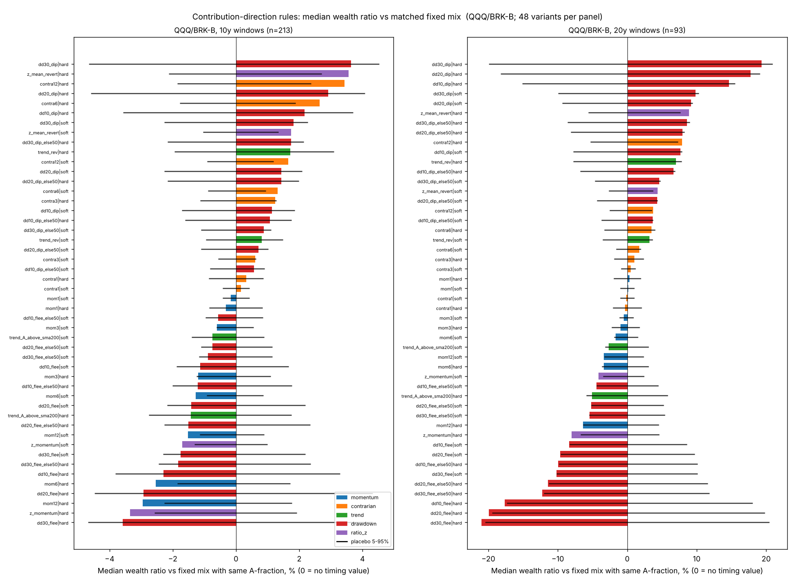
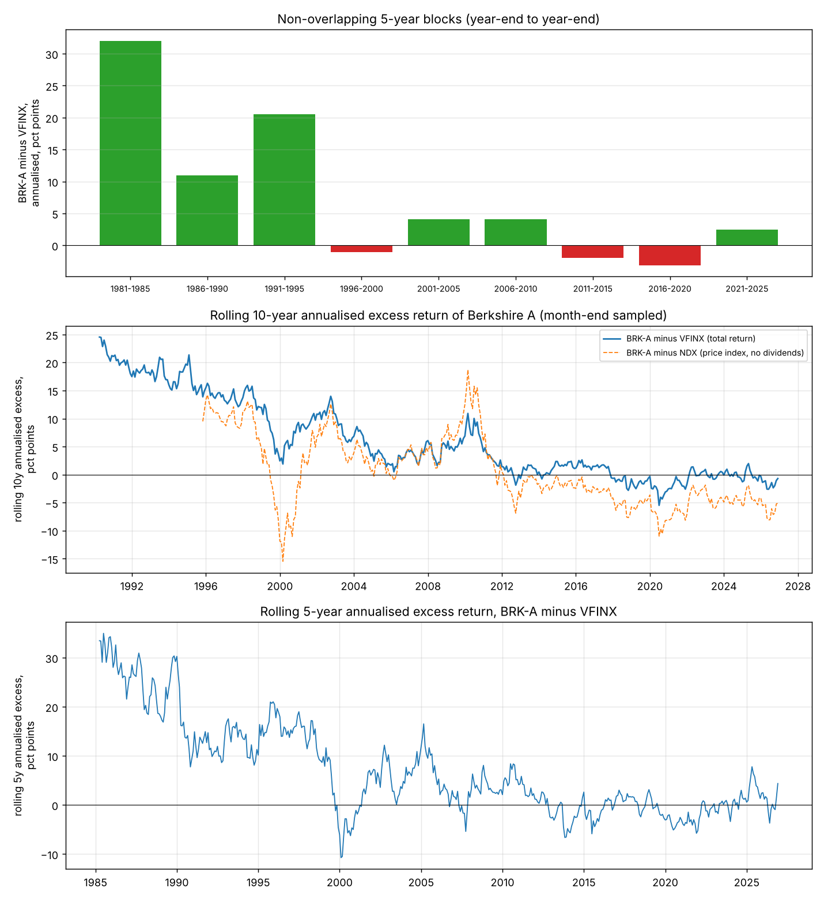
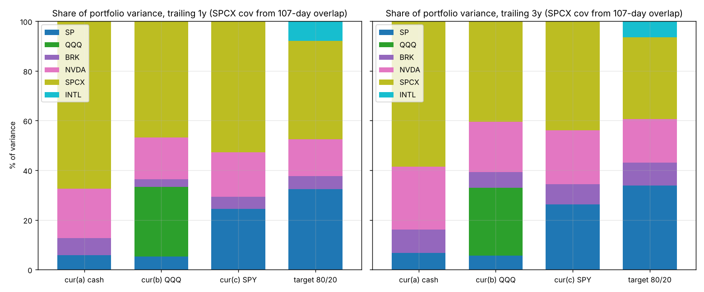

# 定投策略研究报告

数据截至 2026-11-13。所有回测用本仓库的引擎约定：前一日收盘做决定，次日开盘成交，滑点 0.05%，零佣金，允许零股，价格为含分红的复权价。

## 一、结论：照这个做

**目标配比（整个账户）**

| 部分 | 目标 | 内容 |
|---|---|---|
| 底仓 | 85% | VOO 60% + BRK-B 25% |
| 自己玩 | 15%（上限 20%） | NVDA、SPCX 以及以后想买的任何东西，单只不超过 10% |

**现在（近半年没有新钱）**

1. 把那约 2,300 美元的零碎持仓一次性卖掉，全部换成 VOO。不需要分批。
2. NVDA 和 SPCX 不动，也不再加。
3. BRK-B 不动。

做完后账户大约是 VOO 43%、BRK-B 29%、NVDA 14%、SPCX 14%，底仓从 39% 变成 71%。

**以后每个月有 X 美元时（用零股下单）**

1. 看 VOO 占 (VOO + BRK-B) 的比例。低于 70% 就全买 VOO，高于 70% 就全买 BRK-B。每月只下一单。
2. 在 NVDA + SPCX 降到账户的 15% 以下之前，新钱不进"自己玩"的部分。之后每月可以拿 10% 去玩。
3. 按现在的持仓，前约 1,800 美元都会进 VOO。

**每年检查一次**

- 任何单只"自己玩"的股票超过账户 10%，或这部分合计超过 20%：把超出的卖掉，换成底仓。
- VOO 占底仓的比例跑出 60%–80%：卖多的买少的，拉回 70%。账户不到月投额的 100–200 倍之前，这条基本不会触发。

除此之外什么都不用做，不看行情、不择时。

## 二、你问的问题，逐个回答

### 1. 科技强的时候追 SPY/QQQ，还是买伯克希尔？科技跌的时候呢？

**不追涨。固定配比，每月买低于目标的那一个。** 这条规则两个方向都自动覆盖：科技涨得多，VOO 占比就会超标，钱自动去伯克希尔；科技跌了，VOO 占比不足，钱自动去 VOO。

证据（实验 3，每对资产 48 种规则，5 对资产，5/10/20 年滚动定投）：

| 规则（每月的钱全投给……） | 对比"平均配比相同的固定比例"的终值 |
|---|---|
| 过去 12 个月涨得多的那个（追涨） | QQQ/BRK：10 年 -3.0%，20 年 -6.4%；SPY/BRK：约 -2% |
| 过去 12 个月涨得少的那个（买落后者） | 15 个组合全部为正，+1.4% 到 +7.9% |
| QQQ 在 200 日均线上就买 QQQ（趋势） | -1% 到 -5% |
| QQQ 从高点回撤 ≥20% 时买 QQQ，否则买 BRK | 10 年 +2.9%，20 年 +17.8%（基本只靠 2000–02 一段） |

怎么读这些数：

- 追涨在 120 个测试格子里有 118 个输给固定配比。这一条最稳。
- 买落后者的优势很小。只有 5 年期通过了多重检验（在随机信号的"48 选最优"分布里排第 99 百分位以上），10 年和 20 年只是边缘。独立样本大约只有 5–9 个五年期，所以它是"均值回归的迹象"，够不上一个可以依赖的策略。
- 12 个月以内，谁强谁弱对之后的相对表现没有任何预测力。多年尺度的回归只出现在 1999 年以后的样本里，主要来自 2000–02 那一次。

所以不值得为此设计复杂规则。"买低于目标的那个"已经拿到了这点好处的方向，而且不用判断。实测它和死板的 50/50 相比，年化差别在 ±0.3 个点以内，回撤略浅 0.1–0.6 个点。

**你的前提现在其实是反的。** 截至 11 月 13 日：

| | 近 3 个月 | 近 12 个月 | 距历史高点 |
|---|---|---|---|
| BRK-B | +19.0% | +18.0% | 0%（收在新高） |
| SPY | -2.1% | +11.6% | -3.2% |
| QQQ | -6.8% | +10.0% | -10.5% |
| NVDA | -27.5% | -15.8% | -31.9% |
| SPCX | -4.9% | 上市 5 个月 | -34.2% |

现在是科技在跌、伯克希尔在高位。按上面的规则，接下来的钱本来就全进 VOO，和"买落后者"一致。（我之前搜到"伯克希尔跑输标普 31 个点"的新闻是几个月前的，已经过时。）

### 2. "回撤时伯克希尔比标普抗跌"是真的吗？

**大体是真的，但不是每次，而且近年变弱了。**

- 1980 年以来标普 19 次 ≥10% 的回撤里，伯克希尔 13 次跌得更少，5 次是涨的，中位数 -12% 对标普 -17%。
- 最大的几次：2000–02 年伯克希尔 +14%，标普 -48%，纳指 100 -80%；2022 年 -12% 对 -25% 和 -34%；2025 年 +2% 对 -19%。
- 它跌得更多的有 6 次，包括 1990 年和 1998–99 年。2008 年它也跌了 40%，只比标普的 -55% 好一些。2009 和 2020 年见底后的 12 个月，它反弹得比标普少。
- 月度下跌捕获率：全样本 0.47，2013 年以后 0.59。和标普越来越像。

### 3. 底仓到底定投标普还是伯克希尔？

**收益上分不出来，所以按风险来定：标普为主，伯克希尔占底仓三成左右。**

1999 年以来滚动定投（213 个十年窗口、93 个二十年窗口）：

| 每月定投 | 10 年年化中位数 | 10 年较差情形（p10） | 10 年最差 | 20 年中位数 | 20 年最差 |
|---|---|---|---|---|---|
| SPY | 11.3% | 2.9% | -7.9% | 11.3% | 7.7% |
| BRK-B | 11.2% | 4.6% | -0.7% | 11.0% | 7.6% |
| SPY 50 / BRK-B 50 | 11.3% | 4.2% | -3.9% | 11.2% | 7.9% |
| QQQ | 15.9% | 6.8% | -7.5% | 16.3% | 11.6% |

- 标普和伯克希尔怎么配，中位数都在 11.2%–11.4%。伯克希尔只在 46–47% 的窗口里赢标普。
- 加伯克希尔改善的是坏情形（最差十年从 -7.9% 到 -3.9%）。这来自 2000–02 和 2008 两段，独立样本约三个十年。
- **伯克希尔的超额收益已经没有了。** 相对标普每年：1980–99 年 +14.2 个点，2000–12 年 +5.5 个点，2013 年至今 -0.1 个点。"长期跑赢"的印象来自 1995 年以前。

为什么是 25% 而不是更多或更少：

- 不是 0：它和 VOO 的相关性 0.74，是测过的美股标的里唯一明显低于 0.9 的；坏情形更好；不分红。
- 不超过三成：它是一家公司，不是基金。巴菲特已卸任 CEO，历史数据全部来自他在任时期，这一点回测无法检验。超额也已归零，多配没有收益上的理由。

**关于 QQQ**：回测里它全面胜出，所有 10 年和 20 年窗口都赢标普。我没有把它放进底仓，原因有三：这是事后才知道的赢家；它经历过 -83% 的回撤，15 年才回本；标普本身已经很"科技"，近三年 SPY 对 QQQ 的 beta 是 0.70，R² 是 0.90。你"自己玩"的部分已经全是科技，底仓不需要再加。

**关于国际（VXUS）和债券**：回测里都是拖累。2011 年以来每配 20% 国际少约 1.3 个点年化，20% 债券少约 2 个点，后者把最大回撤从 -34% 降到 -26% 左右。但这 15 年只是一轮美股成长周期，"美股永远赢"是这份报告里最不该外推的结论。为了简单我没放进方案；如果你想对冲"只押美国"，可以从 VOO 里分 10% 给 VXUS，这是判断，回测不支持也不否定。

### 4. X 的大小和该买几只的关系

**你的直觉对一半。X 决定的是"稀释现有持仓的速度"，不决定该买几只。**

- 用零股时，X 不构成约束。每月 25 美元分 8 只，权重偏离也在 1.5 个点以内。
- 只有买整股时 X 才重要：月投额低于最贵那只（VOO 约 693、BRK-B 约 593 美元）的 1–2 倍时，经常一股都买不了。每月 100 美元时，5 年里有 20–48 个月空仓，闲置现金 12–36%。
- 多买几只美股基金几乎不分散：VOO 与 VTI 相关性 1.00，与 QQQ、价值、等权都在 0.93 以上。从 1 只加到 5 只美股为主的基金，波动只从 16.7% 降到 15.9%。真正分散的只有伯克希尔、国际和债券黄金。

X 真正影响的事（卖掉零碎仓位之后，不卖 NVDA/SPCX，按现价、零收益估算）：

| 每月 X | NVDA+SPCX 降到 20% 以下 | 降到 15% 以下（之后可以开始"玩"） |
|---|---|---|
| 200 美元 | 约 15 个月 | 约 32 个月 |
| 500 美元 | 约 6 个月 | 约 13 个月 |
| 1,000 美元 | 约 3 个月 | 约 7 个月 |

用真实历史路径模拟会更慢（每月 500 美元降到 20% 的中位数是 8 个月），因为样本里的 NVDA 和特斯拉一直在涨。

账户长大后的变化：账户超过月投额的 100–200 倍时，光靠新钱已经拉不动权重，才需要偶尔卖出再平衡。标普+伯克希尔这种组合 15 年里偏离从没超过 5 个点；含 QQQ 的组合偏离过 8.6 个点。

### 5. 现在的持仓扛不扛得住风险？

**扛不住大跌，主要风险来自 SPCX 和那堆零碎仓位。**

把历史上各资产的真实跌幅套到你现在的 7,000 美元上（SPCX 用替代标的）：

| 情形 | 零碎仓位像 QQQ | 零碎仓位像标普（＝执行第一步之后） | 50/50 标普+伯克希尔 |
|---|---|---|---|
| 2000–02 | -48% | -36% | -11% |
| 2008 | -56% | -57% | -49% |
| 2022 | -33% 至 -35% | -29% 至 -32% | -18% |
| 2025 年 4 月 | -18% 至 -19% | -17% | -8% |

- SPCX 占 14% 的钱，贡献组合 40–67% 的波动。上市以来年化波动约 82%，从 6 月高点最深跌过 -49%。NVDA 再占 17–25%。
- 伯克希尔占 29% 的钱，只贡献 3–10% 的波动。
- 零碎仓位是什么，比 SPCX 用哪个替代标的影响更大。所以第一步先处理它。

**要诚实说的一点**：做完第一步，账户在 2022 那样的行情里仍会亏约 30%（约 2,100 美元），大部分来自 NVDA 和 SPCX。把这两只各修剪到 10% 几乎没用，测算只改善约 2 个点。真正降风险只有两条路：现在把它们砍到各 5% 左右，或者接受这个波动、等新钱稀释。

我建议后者。理由是账户只有 7,000 美元，你未来要投入的钱远多于它，现在亏 30% 的金额相对一生的投入很小；而且两只都已距高点 -32% 到 -34%。但如果你确定看到账户少 2,000 美元会让你停止定投，那就现在把 SPCX 卖一半换成 VOO，这比任何回测结论都重要。

### 6. 近半年怎么调：一次性还是分批？

**一次性。** 实验 5 里一次性和分 6 个月调仓的结果差约 0.5 个点，而结果本身的波动是 4–5 个点，分不出好坏。分批只是多操作几次。

另外要知道：历史上"把高波动仓位换成底仓"在 6 个月内的中位数结果比不动低 1–2%，期间回撤浅 1.5–4 个点。原因是样本里被卖掉的东西（NVDA、QQQ 类）事后一直在涨。调仓买到的是更小的尾部风险，不是更高的预期收益。

### 7. 再平衡规则

**只用新钱补低配的一边就够了。** $500/月、10 年滚动窗口：

| 规则 | 相对"完全不管"的年化 | 期末权重偏离 | 卖出次数 |
|---|---|---|---|
| 完全不管 | — | 1.5–6 个点 | 0 |
| 新钱买低配的 | +0.1 至 +0.2 个点 | 约 1.1 个点 | 0 |
| 每年卖出再平衡 | +0.1 至 +0.2 个点 | 约 0 | 约 5 次 |
| 偏离 10 个点才卖 | 同上 | — | 中位数 0 次 |

规则之间的差别（0.1–0.2 个点）远小于不同起点之间的差别（4–5 个点）。

### 8. "自己玩"的部分给多少

**10–15%，设上限，每年检查。**

| 这部分的结果 | 占每月 10% | 占每月 20% |
|---|---|---|
| 全部亏光 | 终值打九折（年化 -2.0 个点） | 终值打八折（年化 -4.2 个点） |
| 选股偏差（每年落后 8 个点、波动 1.5 倍） | -0.4 个点 | -0.75 个点 |
| 买 QQQ | +0.5 个点 | +1.0 个点 |
| 押中 NVDA / 特斯拉（事后赢家） | +5 至 +8 个点 | +9 至 +13 个点 |

- 10% 的仓位最坏损失有界，所以玩什么都可以。
- 押中了也有问题：20% 的仓位不设上限，10 年后中位数会涨到账户的 40–60%，回到今天这种集中状态。每年卖回上限能把它压在 20–24%，代价是少 0.4–1 个点的收益。

## 三、这份研究不能告诉你的

- **样本很少。** 滚动窗口高度重叠。1999 年以来独立的十年大约 2.8 个，二十年约 1.4 个。所有"X% 的窗口里胜出"都应按这个量级理解。
- **幸存者偏差。** 伯克希尔、QQQ、NVDA 都是事后挑出来的赢家。
- **SPCX 只有 107 个交易日的数据。** 所有涉及它的历史情形都用了替代标的（特斯拉、ARKK、1.6 倍 QQQ），都是猜测。它的波动大部分是个股自身的，替代标的会低估。
- **没算税。** 如果你不是美国税务居民，VOO 的分红通常要预扣 30%（有税收协定的地区更低），伯克希尔不分红所以没有这个问题；卖出是否交税取决于你所在地。这会略微提高伯克希尔的相对吸引力，请按自己的情况核实。
- **那 2,300 美元的零碎仓位我不知道是什么。** 如果里面有你想长期拿的，把它算进"自己玩"的 15% 里，其余照卖。
- 纳指 100 在 1999 年以前用的是不含分红的价格指数，会低估约 1 个点年化。

## 四、文件

| 内容 | 位置 |
|---|---|
| 定投引擎 | `src/dca.py`，测试 `tests/test_dca.py`（17 个） |
| 数据下载 | `scripts/dca/fetch_data.py`（数据在 `data/ohlcv_daily/`，按 `.gitignore` 不入库） |
| 实验 1 现有持仓压力测试 | `scripts/dca/exp1_current_portfolio.py`，`docs/dca/exp1_current_portfolio/` |
| 实验 2 底仓选择 | `scripts/dca/exp2_core_choice.py`，`docs/dca/exp2_core_choice/`（只有数据表和图，没有单独的 findings.md） |
| 实验 3 强弱择时 | `scripts/dca/exp3_tilt_timing.py`，`docs/dca/exp3_tilt_timing/` |
| 实验 4 X 的大小 | `scripts/dca/exp4_contribution_size.py`，`docs/dca/exp4_contribution_size/` |
| 实验 5 组合管理 | `scripts/dca/exp5_*.py`，`docs/dca/exp5_portfolio_mgmt/` |

重跑：先 `python scripts/dca/fetch_data.py`，再逐个运行实验脚本，每个几十秒。
